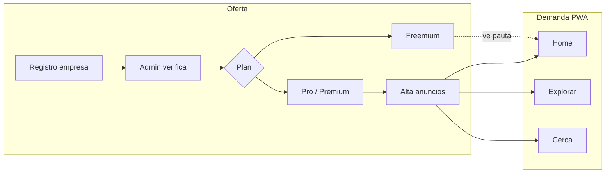

# TraGo — plan: anuncios + registro empresa + suscripción

**Objetivo:** generar ingresos sin romper la tesis (certeza local, promo oficial, 18+, nunca disfrazar pauta de promo vigente).

**Base comercial:** [`PITCH-TRAGO.md`](./PITCH-TRAGO.md) · [`PROPUESTA-FREEMIUM-EQUIPO.md`](./PROPUESTA-FREEMIUM-EQUIPO.md).

**Base técnica ya en repo:**
- `empresas.plan` ∈ `freemium | pro | premium` (`server/src/models/Empresa.js`)
- Panel cadena `/cadena` + registro de empresa
- Catálogo público: `origen: oficial` **o** `origen: empresa` si `verificada`
- Legacy (solo referencia): `SuscripcionNegocioDoc` / `PagoSuscripcionDoc` en `web_next_legacy`

---

## 1. Qué vendemos (no AdSense)

| Producto | Quién paga | Qué recibe | Dónde se ve |
|----------|------------|------------|-------------|
| **Freemium** | Cadena chica | Perfil + hasta 2 promos activas; **ve anuncios de terceros** | App usuario |
| **Pro** | Cadena 3+ locales | Sin ads en su flujo B2B; **promo destacada cerca**; reportes | Home/Cerca |
| **Slot anunciante** | Cadena Pro / marca / local | Banner *Patrocinado* en inventario Free | Home, Explorar, Cerca |
| **Campaña marca** (fase 2) | Destilado / cerveza | Vuelo 7–15 días | Slot nocturno / destacada |

**Regla de oro:** todo anuncio lleva etiqueta fija **Publicidad** / **Patrocinado**. Nunca mezcla con cards de promo oficial (`origen`).

**No hacer al inicio:** Google AdSense (alcohol + poco control).

---

## 2. Flujos de negocio

1. **Empresa se registra** (ya existe camino `/cadena` + auth rol empresa).
2. **Admin verifica** (`verificada: true`) → sus promos pueden entrar al catálogo.
3. **Plan por defecto `freemium`**: límite de promos; no puede marcar `destacada`; no puede crear anuncios.
4. **Upgrade a Pro** (pago o activación manual piloto) → desbloquea destacada + cupo de anuncios + reportes.
5. **Anuncios activos** se sirven a usuarios en superficies Free / feed general, rotados por zona GPS si hay coords.

---

## 3. Modelo de datos (nuevo / extender)

### Extender `empresas`
| Campo | Uso |
|-------|-----|
| `plan` | ya existe |
| `plan_desde` / `plan_hasta` | vigencia del plan |
| `limite_promos` | default 2 freemium; null/∞ pro |
| `ads_enabled` | si puede publicar anuncios (pro/premium) |

### Colección `suscripciones` (piloto-friendly)
- `id_empresa`, `plan`, `estatus` (`trial` \| `activa` \| `vencida` \| `cancelada`)
- `inicia_en`, `termina_en`, `auto_renovar`
- `origen_pago`: `manual` \| `stripe` \| `mp` (Mercado Pago) — **piloto = manual**

### Colección `pagos` (opcional fase 1b)
- monto, moneda `MXN`, `estatus`, `provider_ref`

### Colección `anuncios` (nueva)
| Campo | Notas |
|-------|--------|
| `id_empresa` | dueño |
| `titulo`, `imagen_url`, `cta_url` | creativo |
| `copy` | corto; 18+ si aplica |
| `zonas` | ej. `['gdl']` o bbox |
| `inicia_en` / `termina_en` | vuelo |
| `estatus` | `borrador` \| `en_revision` \| `activo` \| `pausado` \| `rechazado` |
| `peso` | rotación |
| `impresiones` / `clics` | contadores |

**Separación dura:** `anuncios` ≠ `promociones`. El scraper y el catálogo oficial no tocan anuncios.

---

## 4. API (esqueleto)

| Método | Ruta | Quién |
|--------|------|-------|
| `GET` | `/api/anuncios/activos?lat=&lng=&slot=` | Público (PWA) |
| `POST` | `/api/anuncios/:id/impresion` | Público / beacon |
| `POST` | `/api/anuncios/:id/click` | Público |
| `GET/POST/PATCH` | `/api/cadena/anuncios` | JWT rol empresa + plan pro |
| `POST` | `/api/cadena/plan/solicitar-pro` | Empresa (piloto: mail/ticket) |
| `PATCH` | `/api/admin/empresas/:id/plan` | Admin (activar Pro a mano) |
| `PATCH` | `/api/admin/anuncios/:id/moderar` | Admin |

Slots sugeridos: `home_rail` · `explore_feed` · `cerca_list` (máx. 1 cada N cards).

---

## 5. UI

### Panel cadena (`/cadena`)
- Badge de plan + fecha de vencimiento
- Freemium: CTA “Pasar a Pro” + copy del upsell (quitar ads del vecino / destacar cerca)
- Pro: pestaña **Anuncios** (alta, preview, pausar) + toggle **Destacada** en promos
- Contador “promos activas X / límite”

### PWA usuario
- Componente `SponsoredSlot` con label **Publicidad**
- Home: 1 slot bajo explorar o entre near/catálogo
- Explorar: 1 cada ~6 cards
- Cerca: 1 en lista (no encima del pin GPS crítico)
- Respeta night theme / beige; no parece promo oficial

### Admin (mínimo viable)
- Lista anuncios en revisión + aprobar/rechazar
- Activar plan Pro manual (sin pasarela aún)

---

## 6. Reglas de producto (anti-patrones)

1. Anuncio **no** usa `origen: oficial` ni entra al scraper.
2. Sin lectura legible / sin verificación → no inventar creativos.
3. Alcohol en creativo → mismo gate 18+ que el resto de la app.
4. Freemium no puede `destacada: true` (server enforce).
5. Métrica norte sigue siendo GPS × promo × sucursal; ads reportan impresiones/clics **aparte**.

---

## 7. Fases de entrega

### Fase A — Piloto cobrable sin pasarela (1–2 sprints)
1. Enforce plan en API (límite promos, destacada solo Pro).
2. Modelo + CRUD anuncios + moderación admin.
3. `SponsoredSlot` en Home + Explorar.
4. Activación Pro **manual** (admin) + doc de precio lista.
5. Contadores impresión/clic simples.

### Fase B — Suscripción operable
1. UI “Mi plan” + historial `suscripciones`.
2. Mercado Pago o Stripe Checkout (MXN) → webhook actualiza `plan`.
3. Reportes básicos al panel cadena (impresiones del anuncio + métrica norte).

### Fase C — Campaña marca
1. Slot premium / vuelo 7–15 días.
2. Targeting por radio GPS más fino.
3. Facturación y contratos fuera de app (CRM simple).

---

## 8. Precio lista (piloto GDL)

| Plan | Precio | Notas |
|------|--------|--------|
| Freemium | $0 | 2 promos; ve pauta |
| Pro | **$2,900 MXN/mes** zona GDL (lista; ajustar) | Destacada + sin ads propios + cupo 1–3 anuncios |
| Slot extra / marca | Cotizar vuelo | Fase C |

Upsell: “En Free sale el anuncio del vecino; en Pro sales tú cerca y quitas su banner.”

---

## 9. Decisiones abiertas (necesitan ok de Mario)

1. **Pasarela en Fase A:** ¿solo activación manual, o ya Mercado Pago?
2. **Precio Pro lista:** ¿$2,900 o $4,900 / mes zona?
3. **Quién anuncia en Free:** ¿solo Pro/Premium, o también marcas sin sucursal (solo creativo)?
4. **¿Empezamos a codear Fase A** sobre este doc?

---

*Documento de plan de producto/ingeniería. No sustituye forecast auditado.*
